# spark-moe-specialize

This repo prunes two mixture-of-experts (MoE) models for one owner's own traffic, so that both fit at the same time
on one NVIDIA DGX Spark (121 GiB of memory, shared by the CPU and the GPU). The method records the routed experts
that the traffic uses, ranks them, and removes the cold ones. Then it gates each cut against the full model.

- **DeepSeek V4 Flash**, the model of a stock-research bot: 95.39 GiB down to 69.79 GiB, with no loss in the final
  review. Live since 2026-11-06 (K 160), and in its smaller MD form since 2026-11-12.
- **Qwen3.6-35B-A3B**, a fast model for coding, web search and tool calls: 208 of 256 experts per layer, with its
  draft and its vision. It runs beside DeepSeek since 2026-11-14.

**Status:** finished in 2026-11. The repo is the record of one project on one machine, not a maintained tool. The
name was `dsv4-specialize` until the Qwen work. The [timeline](#timeline-of-the-work) shows the nine stages of the
work and the files of each stage. Read [Scope and requirements](#scope-and-requirements) before you try to run any of
it elsewhere.

## Results

**DeepSeek V4 Flash.** [PRUNE.md](PRUNE.md) gives the details. MD is the K 160 prune less 486 cold experts, so each
layer keeps 140 to 160 experts (stages 5 and 6).

| Measure | Stock model | K 160 prune (11-06 to 11-12) | MD prune (live since 11-12) |
|---|---|---|---|
| Routed experts per layer (K) | 216 | 160 | 140 to 160 |
| Experts per token (top-k) | 6 | 5 | 5 |
| Loaded weights | 95.39 GiB | 74.09 GiB (−22%) | 69.79 GiB (−27%) |
| Replay NLL (lower is better; the gate is +3%) | 0.4440 | 0.4524 (+1.89%) | +0.18% against K 160, mean of two replays |
| Bot decode | 33.64 tok/s | 33.98 tok/s (+1.0%) | −1.3% against K 160 |
| Code decode | 38.86 tok/s | 42.07 tok/s (+8.3%) | −4.9% against K 160 |
| LLM judge | — | 44 wins, 19 losses, 51 ties (114 pairs, 3 stock runs) | 25 wins, 16 losses, 35 ties against K 160 |
| Blind human review, 20 pairs | 6 preferred | 9 preferred (5 ties) | 9 preferred, 7 not, 4 ties against K 160 |

- The K 160 rows from the replay on come from the mask of the same point. The pruned files matched the mask on the
  replay, and their speed stayed inside the noise ([PRUNE.md](PRUNE.md) §4).
- Read the judge results as "no loss", not as a gain. Against the stock run of the same day, the judge gives the
  K 160 prune 10 wins and 9 losses. Most of the wins against the older stock runs come from newer market data.

**Qwen3.6-35B-A3B** (`unsloth/Qwen3.6-35B-A3B-NVFP4-Fast`). [QWEN.md](QWEN.md) gives the details.

| Measure | Full model | K 208 prune (live since 11-14) |
|---|---|---|
| Routed experts per layer (K) | 256 | 208 |
| Loaded weights, with the MTP draft | 21.22 GiB | 17.01 GiB (−20%); 17.87 GiB with vision |
| Replay NLL of 60 held-out turns (the gate is +3%) | — | +4.15%: fails the gate |
| Blind judge, 30 of the owner's turns | — | better on 8, worse on 10 (p = 0.81) |
| 80 rare facts of SimpleQA, no search | 15 right, 43 wrong | 10 right, 46 wrong |
| Image questions | 51 of 51 | 51 of 51 |
| Bot decode, with the draft | 99.3 tok/s | 101.8 tok/s |

The K 208 prune fails the NLL gate. The owner chose it because the blind judge finds no visible loss, and because a
larger K does not leave enough memory. The image tests came later, and they also show no loss. See [QWEN.md](QWEN.md) §4.

## What did not work

The negative results are part of the record. Each one has its plan in [plans/](plans/README.md).

| Idea | Result |
|---|---|
| DeepSeek K 144, with every rank tried | +3.29% to +3.90% NLL: fails the gate. K 160 is the floor without a fine-tune |
| DeepSeek top-k 4 | +6.05% NLL |
| Fewer experts per token with a drop rule in the router | +6.4% to +21.8% NLL, and no point is faster |
| Cold cuts past MD (630 and 908 experts) | +0.82% and +1.49% against the K 160 set, and both fail the baseline gate |
| Removal of a whole layer, or of half a layer | Every whole layer costs +2.15% or more. The best half costs +1.06%, and +0.42% after a linear heal |
| 10 of 11 serving settings | They fail their gates or cannot run. A wider draft gives +4.2% decode for 2.39 GiB, and is not deployed |
| Qwen 27B at 256k beside DeepSeek | It needs 34 to 37 GiB, and about 29 GiB is free: no fit |
| Qwen3.6-35B-A3B at K 192 and K 176 | +8.0% and +11.1% NLL |
| Smaller vLLM overhead (prefill budget, eager mode, expandable allocator) | It frees nothing |

## Lessons

- **The workload's own rank beats a public rank.** With the public REAP rank, K 192 already fails (+3.31%). With the
  bot's own rank, K 176 costs only +0.29%.
- **A mask tests a cut in a minute.** It changes the router, not the expert files. Only the winner needs a prune.
- **Fewer experts per token gives back the speed.** A smaller K alone makes the draft model less accurate, so the
  decode gets slower. Top-k 5 in place of 6 fixes it.
- **A small model loses more.** At the same share of the routing, Qwen (3B active parameters) loses about twice as
  much NLL as DeepSeek.
- **The replay has noise.** One folder moves up to 0.6% between windows, so a small cut needs the mean of two
  replays.
- **Swap hides memory pressure.** On this machine the kernel moves idle server pages to swap before the available
  memory falls. Record the free swap as well as the available memory.

## How it works

1. **Capture.** A patched server records the experts that the model picks for each token of the bot's own traffic:
   34 calibration segments, 1.75 M tokens ([capture.py](tools/capture.py), [compose-capture.yml](compose/compose-capture.yml),
   [image-patch/](image-patch/)).
2. **Rank.** `capture.py --rank` orders the experts of each layer by their use. The rank of the live model is
   [results/expert_rank_bot.json](results/expert_rank_bot.json).
3. **Mask.** [mask_checkpoint.py](tools/mask_checkpoint.py) builds a copy in which the router never picks a dropped expert
   (see [The mask](#the-mask)). A mask builds in about a minute and does not change the expert weights.
4. **Top-k.** [topk_checkpoint.py](tools/topk_checkpoint.py) lowers the experts per token from 6 to 5. A smaller K alone
   makes the decode slower, because the draft model gets fewer tokens accepted. Top-k 5 gives the speed back.
5. **Prune.** [prune_experts.py](tools/prune_experts.py) removes the dropped experts from the files and gives the kept
   experts new ids. It removed 28,896 tensors (21.27 GiB) and did no new quantization.

Each test point passes four tests in this order: the replay screen, the speed tests, the full runs and the final
review. The [glossary](#glossary) defines each test.

## Timeline of the work

The work ran in nine stages, in this order. Each stage asked one question about a model or the server. The live
DeepSeek comes from stage 1 (the K 160 prune, live from 2026-11-06 to 11-12) and stage 6 (the MD prune of its cold
experts, live since 2026-11-12). The live Qwen comes from stage 9. The other stages are experiments, and their files
stay in the repo as the record.

```mermaid
flowchart LR
    S1["1. Prune experts<br/>11-02 to 11-07<br/>K 160, top-k 5: live until 11-12"]
    S2["2. Better rank<br/>11-06 to 11-07<br/>K 144 fails"]
    S3["3. Fewer experts per token<br/>11-09 to 11-10<br/>no deploy"]
    S4["4. Serving settings<br/>11-10<br/>KV pin: live"]
    S5["5. Cold experts<br/>11-10 to 11-13<br/>486 experts not needed; more fail"]
    S6["6. Loader patch<br/>11-11 to 11-12<br/>MD prune: live"]
    S7["7. Fewer layers<br/>11-10 to 11-13<br/>zero layers"]
    S8["8. Second model fit<br/>11-13<br/>Qwen 27B does not fit"]
    S9["9. Qwen prune<br/>11-13 to 11-14<br/>K 208 with vision: live"]
    S1 --> S2 --> S3 --> S4 --> S5 --> S6 --> S7 --> S8 --> S9
```



**Start here.** The live model comes from the three weight tools of stage 1: [mask_checkpoint.py](tools/mask_checkpoint.py),
[topk_checkpoint.py](tools/topk_checkpoint.py) and [prune_experts.py](tools/prune_experts.py). Read them first.

**Shared by all stages:** [run_lib.sh](scripts/run_lib.sh) (the safety rules of every run script),
[compose-mask.yml](compose/compose-mask.yml) (the base of every test boot), [speed_result.py](tools/speed_result.py) (the speed
result of a test point) and [overnight_guard.sh](scripts/overnight_guard.sh) (it restores the live server at night if the
server is down).

### 1. Prune the routed experts to K 160 (2026-11-02 to 11-07): live until 2026-11-12

**Question:** can the model lose the experts that the bot rarely uses, fit in about 72 GiB, and keep its quality? A
grid of masks tested K and top-k on the replay screen. The bot's own rank beat the public REAP rank: with REAP, K 192
already fails the NLL gate (+3.31%), but the bot rank costs only +0.29% at K 176. Top-k 4 fails (+6.05%). The pick,
K 160 at top-k 5, passed the final review. The physical prune went live on 2026-11-06, and a draft model built for
the bot rank followed on 2026-11-07.

- Plans: [PLAN_OVERNIGHT_MASK_GRID.md](plans/PLAN_OVERNIGHT_MASK_GRID.md),
  [PLAN_OVERNIGHT_TOPK.md](plans/PLAN_OVERNIGHT_TOPK.md), [PLAN_FINAL_REVIEW.md](plans/PLAN_FINAL_REVIEW.md) and
  [PLAN_PHYSICAL_PRUNE.md](plans/PLAN_PHYSICAL_PRUNE.md). The summary is [PRUNE.md](PRUNE.md) §1–§5.
- Tools: [capture.py](tools/capture.py), [mask_checkpoint.py](tools/mask_checkpoint.py), [topk_checkpoint.py](tools/topk_checkpoint.py),
  [prune_experts.py](tools/prune_experts.py), [prune_run.sh](scripts/prune_run.sh) and [check_routed.py](tools/check_routed.py).
- Test boots: [compose-capture.yml](compose/compose-capture.yml), [serve-v1.sh](image-patch/serve-v1.sh) and
  [compose-mem073.yml](compose/compose-mem073.yml).
- Run scripts: [topk_run.sh](scripts/topk_run.sh), [prune_boot.sh](scripts/prune_boot.sh), [mem_boot.sh](scripts/mem_boot.sh) and
  [draft_test.sh](scripts/draft_test.sh).
- Result: [results/expert_rank_bot.json](results/expert_rank_bot.json), the expert rank of the live model.

### 2. Try K 144 with a better rank (2026-11-06 to 11-07): fails

**Question:** can a better rank push the prune to K 144 (about 68 GiB)? The first rank counted how often the router
picked each expert. A patch of the capture also recorded the router weights, so the new ranks could order the experts
by their contribution. K 144 failed the NLL gate with every rank (+3.29% to +3.90%). So K 160 is the floor for this
model without a fine-tune.

- Plan: [PLAN_BETTER_RANK.md](plans/PLAN_BETTER_RANK.md).
- Tools: [rank_data.py](tools/rank_data.py), [rank_report.py](tools/rank_report.py), and the weights patch in
  [image-patch/](image-patch/) (`base_router.py`, `routed_experts_capturer.py` and `capture-weights.diff`).
- Run scripts: [capture_run.sh](scripts/capture_run.sh), [rank_masks.sh](scripts/rank_masks.sh) and [rank_night.sh](scripts/rank_night.sh).

### 3. Use fewer experts per token (2026-11-09 to 11-10): no deploy

**Question:** can each token use fewer than 5 experts, for a faster decode? A router patch dropped expert slots by a
rule, and it could rescale the kept weights (a gain anchor). Every cut below 5 experts failed the NLL gate (+6.4% to
+21.8%), and no point was faster than the live server. The anchored top-5 was a little better on the replay, but the
judge found no gain. So nothing changed on the live server.

- Plan: [PLAN_FEWER_EXPERTS.md](plans/PLAN_FEWER_EXPERTS.md). The summary is [PRUNE.md](PRUNE.md) §6.
- Tools: the router patch in [image-patch/](image-patch/) (`moe_drop.py`, `router-drop.diff` and `build_router.sh`),
  [profile_report.py](tools/profile_report.py) and [fewer_report.py](tools/fewer_report.py).
- Test boot: [compose-drop.yml](compose/compose-drop.yml).
- Run scripts: [fewer_night.sh](scripts/fewer_night.sh) and [fewer_stepf.sh](scripts/fewer_stepf.sh).

### 4. Tune the serving settings (2026-11-10): the KV pin is live

**Question:** can the server settings give more speed or free memory, with no change to the weights? Of 11 ideas, one
is live: a KV cache pin of 7.25 GiB frees 0.75 GiB. A wider draft model gives +4.2% decode speed for 2.39 GiB, but it
is not deployed. The other ideas fail their gates or cannot run on this stack.

- All files: [serve-tune/](serve-tune/README.md), with its own plan, tools, data and write-up.
- Also: `mask_checkpoint.py --keep-per-layer`, for a different K in each layer.

### 5. Drop the cold experts (2026-11-10 to 11-13): the bot does not need them

**Question:** does the bot need the experts that its traffic rarely uses? The default mask rule keeps 257 "mandatory"
tool experts, and each gets less than 0.1% of the routing weight of its layer. Two replay windows tested masks without
these tool experts, without the coldest ordinary experts, and without both. The cut of both sets, 486 experts, costs
+0.18% NLL against the live set over two replays, under the limit of 0.5%. A prune of these experts would free about
4.29 GiB. But a mask frees no memory, and after the cut each layer keeps a different number of experts. A third
window on 2026-11-12 tested two larger cuts: S15 (630 experts, 5.56 GiB) and S20 (908 experts, 8.01 GiB). Both cost
too much: +0.82% and +1.49% NLL against the live set, and both fail the baseline gate. So MD (stage 6) is the limit
of the cold cut on this traffic.

- Plans: [PLAN_COLD_EXPERTS.md](plans/PLAN_COLD_EXPERTS.md) and [PLAN_COLD_CUT2.md](plans/PLAN_COLD_CUT2.md).
- Tools: [cold_sets.py](tools/cold_sets.py) and `mask_checkpoint.py --drop-file`.
- Run script: [cold_replay.sh](scripts/cold_replay.sh).

### 6. Prune the cold experts with a loader patch (2026-11-11 to 11-12): live

**Question:** can the runtime load a prune with a different number of experts in each layer? The cut of stage 5
keeps 140 to 160 experts per layer, but the runtime accepts one number for all layers. The plan patches the config,
the router, the weight loader and the MoE runtime. The MoE runtime must share one scratch buffer across all expert
counts: one buffer for each count would use more memory than the prune frees. The goal is the prune of the 486 cold
experts at about 69.80 GiB, with the replay result and the speed of the mask. The first step is done:
`prune_experts.py` builds a folder with a different K in each layer. The patch, its tests and the prune of MD are
done too: on the GPU, a layer of the MD prune gives the same output as the same experts of the K 160 prune, bit for
bit, and all expert counts share one scratch buffer. In the test window, the MD prune loaded 69.79 GiB, left
4.18 GiB more memory free, matched the mask on two replays (+0.13%) and kept the bot speed (−1.3%). The code decode
test is 4.9% slower. The deploy review passed on 2026-11-12: the full runs of the MD prune against the live model,
the LLM judge (25 W / 16 L / 35 T, with two controls) and the blind review (9 W / 7 L / 4 T). The MD prune went live
on 2026-11-12 at 18:00, with 2 min 53 s of downtime. On the live server it takes 9.9% more time per model call than
the K 160 prune: it writes longer answers at the same decode rate. You kept it. The freed memory is for the second
model of the router plan.

- Plan: [PLAN_LOADER_PATCH.md](plans/PLAN_LOADER_PATCH.md).
- Tools: [prune_experts.py](tools/prune_experts.py) (§5.1 of the plan), and the patch (§5.2):
  [image-patch/per-layer-experts.diff](image-patch/per-layer-experts.diff),
  [image-patch/build_perlayer.sh](image-patch/build_perlayer.sh) and [compose-perlayer.yml](compose/compose-perlayer.yml).
- Checks: [loader_kernel_check.py](tools/loader_kernel_check.py). Run script: [loader_window.sh](scripts/loader_window.sh).
- The deploy review: [PLAN_MD_REVIEW.md](plans/PLAN_MD_REVIEW.md). Run scripts: [review_live.sh](scripts/review_live.sh)
  and [review_window.sh](scripts/review_window.sh), with the safety net [review_finish.sh](scripts/review_finish.sh). Report:
  [review_report.py](tools/review_report.py).
- The deploy: [PLAN_MD_DEPLOY.md](plans/PLAN_MD_DEPLOY.md). Script: [deploy_md.sh](scripts/deploy_md.sh), with the compose file
  [deploy/compose-md149t5.yml](deploy/compose-md149t5.yml) of the live server.

### 7. Remove whole layers (2026-11-10 to 11-13): zero layers

**Question:** can the model skip whole layers, or one half of a layer? A runtime patch skips any set of blocks (a
whole layer, or its attention or FFN half), and an eager probe boot measures each block on calibration data. Since the
MD prune, the replay gate leaves almost no budget, so a cut must cost near zero. The probe window screened 28 blocks.
Every whole layer costs +2.15% NLL or more, and every pair +2.43% or more. The best block is the FFN half of
layer 24. In the replay window, the model with no skip sits on the gate (+3.00%). The skip of that FFN half costs
+1.06% more. A linear heal map, fitted in closed form, removes 61% of that cost, but +0.42% is left. So no block
fits, and nothing changed on the live server. The patch, the heal and the scripts stay as tools.

- Plan: [PLAN_FEWER_LAYERS.md](plans/PLAN_FEWER_LAYERS.md).
- The patch: [image-patch/layer_skip.py](image-patch/layer_skip.py) (the skip set, the probe sums, the skip file),
  [image-patch/layer-skip.diff](image-patch/layer-skip.diff), [image-patch/build_skip.sh](image-patch/build_skip.sh),
  [compose-skip.yml](compose/compose-skip.yml) and [compose-skip-v1.yml](compose/compose-skip-v1.yml). Tests:
  [test_layer_skip.py](tests/test_layer_skip.py) and [test_layer_skip_gpu.py](tests/test_layer_skip_gpu.py), run by
  [test_layer_skip.sh](tests/test_layer_skip.sh) in the server image.
- The client: [layer_screen.py](tools/layer_screen.py) (the data pick, the BI pass, the screen, the greedy rounds, the
  report, the heal fit), with [test_layer_screen.py](tests/test_layer_screen.py).
- Run scripts: [skip_probe.sh](scripts/skip_probe.sh) and [skip_replay.sh](scripts/skip_replay.sh), with their dry run
  [test_skip_scripts.py](tests/test_skip_scripts.py). The summary is [PRUNE.md](PRUNE.md) §7.

### 8. Fit a second model beside DeepSeek (2026-11-13): Qwen 27B does not fit

**Question:** does Qwen 27B (NVFP4) with a 256k context fit beside the live checkpoint? No. A window on 2026-11-13
measured Qwen alone at one sequence: it uses 34.0 GiB with no draft and about 37 GiB with its draft, and about
29 GiB is available. The DeepSeek savings that do not change the output give at most 8.3 GiB, less than the gap with
a margin. Qwen 27B is also slower than DeepSeek here: 30.8 tok/s with its draft and 11.1 without, against 35.3. A
second window measured two MoE candidates with 3B active parameters. Nemotron-3.5-Lightning-30B-A3B is the fastest
and the smallest: 74 tok/s in 25.5 GiB with no draft, and 127 tok/s in 28.8 GiB with its DSpark draft. The owner
chose Qwen3.6-35B-A3B (99 tok/s with its draft) for its balance of reasoning and speed, and it needed a prune to fit.

- Plan: [PLAN_SECOND_MODEL_FIT.md](plans/PLAN_SECOND_MODEL_FIT.md).
- Run script: [qwen_fit.sh](scripts/qwen_fit.sh), with its client [qwen_fit.py](tools/qwen_fit.py) and the dry run
  [test_qwen_fit.py](tests/test_qwen_fit.py).

### 9. Prune Qwen3.6-35B-A3B and run it beside DeepSeek (2026-11-13 to 11-14): live

**Question:** can a prune of the routed experts let Qwen3.6-35B-A3B run with its MTP draft at 128k beside DeepSeek?
Yes, at a cost on the NLL gate. The rank comes from 99 segments of the owner's Claude Code transcripts, the bot
sessions and the owner's repositories (2.44M tokens). Every pruned point fails the NLL gate: +4.2% at K 208, +8.0%
at K 192 and +11.1% at K 176. The gate holds only above about K 224, which leaves too little memory. A blind judge
then found no visible loss at K 208, and a facts test found a drop inside its noise. The owner chose K 208. The draft experts in NVFP4 save
1.09 GiB more, with no change to the output of the target.

On 2026-11-14 both servers ran at the same time, with no stop of DeepSeek. A watch stops Qwen, and only Qwen, if the
available memory falls below 2 GiB. Under load the lowest available memory was 7.3 GiB without vision and 5.7 GiB
with vision, but swap holds part of that: about 4.6 GiB of idle server pages. Each model alone keeps its speed. When
both decode at once, they share the memory bandwidth, and each runs at about half speed. Vision passed 51 of 51 image
questions and costs 2.36 GiB, and it stays on. A 24-hour gate of normal use ends on 2026-11-15 at 17:33.

- The summary: [QWEN.md](QWEN.md). The plan: [PLAN_QWEN_PRUNE.md](plans/PLAN_QWEN_PRUNE.md), §6 (the capture), §7
  (the gates, the facts test and the NVFP4 draft) and §8 (both servers, and vision).
- Tools: [qwen_data.py](tools/qwen_data.py) (the calibration data), [capture.py](tools/capture.py) (the routing counts),
  [qwen_prune.py](tools/qwen_prune.py) (the prune), [qwen_gate.py](tools/qwen_gate.py) (the replay gate),
  [qwen_facts.py](tools/qwen_facts.py) (the facts test and the side-by-side), [qwen_vision.py](tools/qwen_vision.py) (the image
  test), [qwen_draft_quant.py](tools/qwen_draft_quant.py) (the NVFP4 draft experts) and
  [qwen_mtp_patch/sitecustomize.py](qwen_mtp_patch/sitecustomize.py) (in vLLM 0.33, the MTP draft of a pruned Qwen
  keeps its own expert count).
- Both servers: [pair_run.sh](scripts/pair_run.sh) (the boot beside DeepSeek and the load tests) and
  [pair_watch.sh](scripts/pair_watch.sh) (the memory watch). [cap_switch.sh](scripts/cap_switch.sh) is the DeepSeek context cap,
  written but not used.

## Documents

| Document | Read it for |
|---|---|
| [PRUNE.md](PRUNE.md) | The DeepSeek account: why, the grid of test points, the final review, the physical prune, the open items, and the tests of fewer experts per token and fewer layers |
| [QWEN.md](QWEN.md) | The Qwen account: the prune, the gate and the decision, both servers at once, and vision |
| [plans/README.md](plans/README.md) | The index of the test plans, and how to read their old paths. The scripts cite the plans by section number |
| [serve-tune/README.md](serve-tune/README.md) | The serving settings: 11 ideas for speed and memory, with no change to the weights |
| [RUNBOOK.md](RUNBOOK.md) | The operator steps: the safety rules of the run scripts, the rebuild of the live checkpoint, a mask test by hand and the capture by hand |

The plans are working notes. They speak to the owner as "you", and they record each decision as it was made.

## Scope and requirements

The tools and the scripts fit one machine and one bot. They need these parts:

- **Hardware:** one NVIDIA DGX Spark (GB10). The CPU and the GPU share 121 GiB of memory. The stock DeepSeek alone
  fills most of it; the two pruned models fit together with the help of a 16 GiB swap file.
- **Server:** the vLLM server of
  [MiaAI-Lab/DeepSeek-v4-Flash-One-DGX-Spark](https://github.com/MiaAI-Lab/DeepSeek-v4-Flash-One-DGX-Spark), in the
  image `ghcr.io/0xsero/deepseek-v4-flash-0731-spark-sparkinfer` (the compose files pin a digest). The scripts expect
  it in `~/Projects/DeepSeek-v4-Flash-One-DGX-Spark`. The live server is a local compose file in that folder,
  `compose-md149t5.yml` (container `deepseek-v4-flash-md149t5-deepseek-v4-flash-1`, since 2026-11-12). The
  `start.sh` and `stop.sh` of that repo control the stock model only.
- **Checkpoint:** the EXL3 checkpoint of DeepSeek V4 Flash in `data/tp1` of that folder, and its DSpark draft. The
  weight tools read this layout only.
- **Python:** Python 3 (tested with 3.13) and numpy run the weight tools and most unit tests. torch and vLLM run only
  inside the server image.
- **Qwen:** the checkpoint `unsloth/Qwen3.6-35B-A3B-NVFP4-Fast`, served by vLLM 0.33 from its own venv as a plain
  process on port 8889, not in a container.
- **The bot repo:** `czhou578/stock-research-agent` is private. It holds the eval harness (`model_eval/`) and the
  recorded bot sessions. Without it, the capture, the replay and the full runs cannot run. It also holds four
  documents that this repo cites by name: `MODEL_PRUNE.md` (what runs now, and how to go back to the stock model),
  `PLAN_MODEL_SPECIALIZE.md` (the method and the harness), `PLAN_E2E_RUNNER.md` (the full runs) and
  `PLAN_MODEL_ROUTER.md` (two models in memory).
- **Paths:** the scripts and the compose files use the paths of the owner's machine.

You can reuse these parts:

- the method and the test results,
- the weight tools, on a DeepSeek V4 Flash EXL3 checkpoint of the same layout, with a rank file from
  `capture.py --rank`,
- the router patch ([image-patch/moe_drop.py](image-patch/moe_drop.py)), as an example of a drop rule in the vLLM
  router.

## Glossary

| Term | Meaning |
|---|---|
| The bot | The stock-research agent that the model serves. It runs on Hermes, calls tools and writes reports |
| MD | The live DeepSeek prune: the K 160 prune less 486 cold experts (M1, the cold tool experts, and D1, the cold ordinary experts) |
| Qwen server | The pruned Qwen3.6-35B-A3B on port 8889, beside the live server |
| Live server | The model server that the bot uses, on port 8888. Test boots use port 8890, so the bot cannot reach a test model |
| Routed expert | One of the 216 feed-forward experts of a MoE layer. The model has 43 layers and picks 6 experts for each token |
| K | The number of routed experts that each layer keeps |
| Top-k | The number of routed experts that each token uses |
| Rank | An order of the experts of each layer by their use. The bot rank comes from the bot's own traffic. REAP is the public rank that comes with the checkpoint (`REAP_K216_PLAN.json`) |
| Mandatory expert | One of the top 32 experts of a layer in either tool category of the REAP rank. `mask_checkpoint.py` keeps it, unless `--drop-file` lists it |
| Mask | A copy of the checkpoint in which the router never picks a dropped expert. All 216 experts still load, so a mask tests the quality, not the memory |
| Prune | A copy that holds only the kept experts. It frees the memory |
| Replay screen | The first quality test: 60 recorded bot turns. It reads the NLL of the recorded output, the decisions and the tool names |
| NLL | The negative log-likelihood of the recorded output, summed over the replay. Lower is better. The NLL gate allows at most +3% against the stock model |
| Speed tests | The bot decode test replays recorded bot requests. The code decode test runs the benchmark script of the server repo. A change counts only above the noise floor |
| Full runs | The bot runs held-out prompts end to end on the test model, and gates check the results |
| Final review | An LLM judge and a blind human review compare the replies of the full runs with the replies of the stock model |
| DSpark | The draft model of the speculative decoding, cut from the model's own multi-token-prediction layer. It proposes 5 tokens, and the target model checks them in one pass |
| Acceptance | The mean number of draft tokens that pass the check in one step |
| EXL3 | The quantization format of the checkpoint |
| Model Runner V1, V2 | Two engine modes of vLLM. The live server uses V2. Only V1 accepts the flag that returns the routed experts, so the capture uses V1 |
| Test window | A time in which a run script stops the live server, runs test boots and restores the live server |

## Files

The repo root holds only the documents. The files are in these folders:

| Folder | Content |
|---|---|
| [tools/](tools/) | The Python tools: the weight tools, the rank tools, the report tools and the Qwen tools |
| [scripts/](scripts/) | The run scripts and their libraries (`run_lib.sh`, `job_lib.sh`) |
| [compose/](compose/) | The compose files of the test boots |
| [deploy/](deploy/) | The compose files of the live server (`deploy_md.sh prepare` copies them into the server folder) |
| [image-patch/](image-patch/) | The patches of the server image, their build scripts and `serve-v1.sh` |
| [qwen_mtp_patch/](qwen_mtp_patch/sitecustomize.py) | The `sitecustomize` hook of the Qwen server |
| [serve-tune/](serve-tune/README.md) | The serving settings, with their own plan, tools, data and write-up |
| [agent-eval/](agent-eval/) | The agent capacity test: the agent loop, the sandbox, the checks and the 40 tasks (`plans/PLAN_AGENT_CAPACITY.md`), with its own tests |
| [tests/](tests/) | The tests |
| `data/` | Not in git: the checkpoints, the Qwen data, the kernel cache copy, the capture and probe output, the history |
| [plans/](plans/README.md) | The plans |

The files moved into these folders on 2026-11-18. The plans keep the old paths: each tool, script, compose file and
test was in the repo root. The tag `root-layout-2026-11-18` is the last commit with that layout.

The tables below sort the files by type. The [timeline](#timeline-of-the-work) sorts them by stage.

Run the Python files with the stock-research venv: `~/.hermes/stock-research/.venv/bin/python`.

`PLAN_MODEL_SPECIALIZE.md`, `PLAN_MODEL_ROUTER.md` and `PLAN_E2E_RUNNER.md` are in the private bot repo (see
[Scope and requirements](#scope-and-requirements)). The other plans are in [plans/](plans/README.md).

**Weight tools.** Each tool writes a new folder and never changes its source.

| File | Use |
|---|---|
| [mask_checkpoint.py](tools/mask_checkpoint.py) | Builds `tp1-mask-k{K}/`: K of 216 experts per layer stay (`PLAN_MODEL_SPECIALIZE.md` §5.3). With `--rank <rank file>`, the bot rank decides the dropped experts (§6.5); the folder is then `tp1-botmask-k{K}/`. With `--keep-per-layer FILE` (a JSON list from `serve-tune/alloc_k.py`), each layer keeps its own K; `--out` is then needed. With `--drop-file FILE` (from `cold_sets.py`), it drops exactly the listed ids, a mandatory expert too |
| [cold_sets.py](tools/cold_sets.py) | The drop files of `plans/PLAN_COLD_EXPERTS.md` §4: R0 (the live set as a mask), M1 (cold tool experts), D1 (cold ordinary experts) and MD (both). `--share 0.15 0.2` adds S15 and S20 (`plans/PLAN_COLD_CUT2.md` §2): MD plus every expert below that weight share. `--report R0.jsonl POINT.jsonl` compares a replay with R0 (§5.2) |
| [topk_checkpoint.py](tools/topk_checkpoint.py) | Builds a top-k copy of a tp1 folder (§8): `--source data/tp1-botmask-k160 --top-k 5 --out data/tp1-botmask5-k160`. `--check` runs the self-check only |
| [prune_experts.py](tools/prune_experts.py) | Builds a physically pruned copy of a mask folder (`PLAN_PHYSICAL_PRUNE.md` §3): the dropped experts leave the files, and the kept experts get the new ids 0 … K−1. A mask with a different K in each layer gives a folder for the loader patch (`plans/PLAN_LOADER_PATCH.md` §4.1). `--check` runs the self-check only |
| [prune_run.sh](scripts/prune_run.sh) | Runs `prune_experts.py` in a root container from the server image, because the 43 expert files of `data/tp1` are `root:600`. The main server stays up |
| [check_routed.py](tools/check_routed.py) | The `PLAN_MODEL_SPECIALIZE.md` §5.2 check: no dropped expert in the routing of a test boot |
| [speed_result.py](tools/speed_result.py) | The §4.4 speed result of one test point, from the files in `results/` |
| [fewer_report.py](tools/fewer_report.py) | The replay table of the points of `plans/PLAN_FEWER_EXPERTS.md` §7 against the baseline, and the decision for Phase D (`--decide`) |

**Rank tools.** They need the bot repo's eval worktree, `~/Projects/stock-research-model-eval`: `capture.py` and
`rank_data.py` import its `model_eval/replay.py`, and the rank data is its `model_eval/data/rank/` (out of git). They
moved here from the bot repo's `model_eval/` on 2026-11-08.

| File | Use |
|---|---|
| [capture.py](tools/capture.py) | The client of the capture boot (`PLAN_MODEL_SPECIALIZE.md` §6.2, `plans/PLAN_BETTER_RANK.md` §4): per segment, the counts of the routed experts and, with `--sums`, the router weights. `--rank` writes `expert_rank_<order>.json` |
| [junk_routes.py](tools/junk_routes.py) | The client of the route capture of the junk prompts (`plans/PLAN_JUNK_CAPTURE.md` §4): `smoke` checks the routing array and the sums file; `capture` sends the probe prompts (raw, `--rounds` times) and the last-turn prompt of each pilot transcript, each one cold, and writes per request the counts over the prompt and its last 256 rows, the ids of the probe position and the weight sums |
| [code_rank.py](tools/code_rank.py) | The rank that counts coding traffic (`plans/PLAN_CODE_RANK.md` §5): orders the experts that MD drops in layers 3-42 by their coding weight share, draws the curve of the dropped bot, pilot, c2 and c3 weight as experts return to MD, and writes the drop files of the candidates code1 (c3 at the K 160 level) and code2 (c2 at 7.5%) |
| [rank_data.py](tools/rank_data.py) | Merges the exports into `model_eval/data/rank/sessions.jsonl` and keeps the held-out sessions out (`plans/PLAN_BETTER_RANK.md` §3) |
| [profile_report.py](tools/profile_report.py) | The routing profile of a capture with `ROUTING_PROFILE=1` (`plans/PLAN_FEWER_EXPERTS.md` §5): the share of the 5th and 6th experts per layer and skill, the experts per token and the window union of each drop rule, and the threshold for point C5 |
| [rank_report.py](tools/rank_report.py) | Compares the rank files in `results/`: the routing share that each K step removes, and the overlaps (`plans/PLAN_BETTER_RANK.md` §5) |

**Test boots.** Each compose file serves on port 8890, so the bot (port 8888) cannot reach a test model.

| File | Use |
|---|---|
| [compose-mask.yml](compose/compose-mask.yml) | Boots `tp1-${MASK_NAME}-k${MASK_K}`. `DRAFT_DIR` mounts another DSpark draft; `MASK_EXTRA_ARGS` adds vLLM flags |
| [compose-mem073.yml](compose/compose-mem073.yml) | Override for `compose-mask.yml`: `GPU_MEMORY_UTILIZATION` 0.73 and 128k context (`PLAN_MODEL_ROUTER.md` §3) |
| [compose-drop.yml](compose/compose-drop.yml) | Override for `compose-mask.yml`: the router patch with its rule (`MOE_DROP`, `MOE_NORM`, `MOE_LAYERS`) and an 8 GiB KV cache (`plans/PLAN_FEWER_EXPERTS.md` §6) |
| [compose-perlayer.yml](compose/compose-perlayer.yml) | Override for `compose-mask.yml`: the loader patch, so a folder with a different expert count in each layer loads (`plans/PLAN_LOADER_PATCH.md` §4). A uniform folder loads as in the stock image. Build the two files first with `image-patch/build_perlayer.sh` |
| [compose-capture.yml](compose/compose-capture.yml) | The expert capture: the stock model with Model Runner V1, no DSpark, `--enable-return-routed-experts` and the weights patch. `ROUTING_PROFILE=1` adds the routing profile; `CAPTURE_UTIL` and `CAPTURE_EXTRA_ARGS` change the boot check and add vLLM flags |
| [serve-v1.sh](image-patch/serve-v1.sh) | Runs the server's serve script with Model Runner V1 (for `compose-capture.yml` only) |
| [image-patch/](image-patch/) | The weights patch (`PLAN_BETTER_RANK.md` §4.1): the patched `base_router.py` and `routed_experts_capturer.py`, and `capture-weights.diff`, the change against the image. `patch -R -p1` with the diff gives back the original files. The router patch (`PLAN_FEWER_EXPERTS.md` §6): `moe_drop.py` (the drop rule and the gain anchor) and `router-drop.diff`; `build_router.sh` applies the diff to the image's router file (not in git). The loader patch (`plans/PLAN_LOADER_PATCH.md` §4): `per-layer-experts.diff` changes the image's `exl3.py` and DeepSeek V4 `model.py`; `build_perlayer.sh` applies it and writes `image-patch/perlayer/` (not in git) |

**Run scripts.** Each script stops the live server, runs its test boots and restores the live server. Read the
safety rules in [RUNBOOK.md](RUNBOOK.md) before you start one.

| File | Use |
|---|---|
| [run_lib.sh](scripts/run_lib.sh) | The shared functions and safety rules of the scripts below. A script sets `LOG`, `RESTORE_TAG` and, if it needs them, `TEST_COMPOSE`, `TEST_PROJECT` and `MASK`, then sources this file. `MAIN_COMPOSE` and `MAIN_CONTAINER` name the live server (default: `compose-md149t5.yml`) |
| [job_lib.sh](scripts/job_lib.sh) | Shows a script on the machine-dash page (`http://127.0.0.1:8470`). In a tmux session, `run_lib.sh` and `overnight_guard.sh` run under `job run`, and report their waits and phases. See [RUNBOOK.md](RUNBOOK.md) |
| [topk_run.sh](scripts/topk_run.sh) | The top-k test night (`PLAN_OVERNIGHT_TOPK.md` §5 and §6) |
| [prune_boot.sh](scripts/prune_boot.sh) | The test boot of the pruned folder: replay, speed tests (`PLAN_PHYSICAL_PRUNE.md` §6) |
| [mem_boot.sh](scripts/mem_boot.sh) | The memory test boot at 0.73 and 128k: boot lines, free memory at idle and under load (`PLAN_MODEL_ROUTER.md` §3) |
| [draft_test.sh](scripts/draft_test.sh) | The pruned model with another DSpark draft (`DRAFT_DIR`): the two decode tests (`PLAN_PHYSICAL_PRUNE.md` §7) |
| [capture_run.sh](scripts/capture_run.sh) | The capture boot (`PLAN_BETTER_RANK.md` §4): a smoke test of the sums file, the capture of `model_eval/data/rank`, the rank files |
| [junk_capture.sh](scripts/junk_capture.sh) | Window 1 of `plans/PLAN_JUNK_CAPTURE.md` (§5): stops Qwen and DeepSeek, boots the stock model from `compose-capture.yml` and `compose-capture-junk.yml` (KV pin 6.5 GiB, 131072 tokens) under a memory guard, checks the server and the KV size, runs `junk_routes.py smoke` and `capture`, then restores DeepSeek and Qwen |
| [review_code226.sh](scripts/review_code226.sh) | The review window of `plans/PLAN_CODE226_DEPLOY.md` §5: md at its live settings (one replay, speed) and code226 at the deploy settings (160k context cap with `compose-cap.yml`, two replays, speed, prefill probe), with one boot more at the KV need plus 4%; then the restore, Qwen, and the gates |
| [rank_masks.sh](scripts/rank_masks.sh) | Builds the mask folders of `PLAN_BETTER_RANK.md` §6 from the stock model (`RANK_NEW` picks the rank file). No downtime |
| [rank_night.sh](scripts/rank_night.sh) | Masks on the replay screen (`PLAN_BETTER_RANK.md` §6). `POINTS` lists them as `NAME:K`; the default is the three masks of §6.1 |
| [fewer_night.sh](scripts/fewer_night.sh) | The test night of `plans/PLAN_FEWER_EXPERTS.md`: the routing profile (Phase A), then the replay points C1–C5 and C0 on `tp1-botmask-k160` with `compose-drop.yml` (Phase C), then 5 bot decode runs on the chosen point and 5 on the live server (Phase D). `BOOT_MIN_GIB` makes each boot wait for that much available memory |
| [fewer_stepf.sh](scripts/fewer_stepf.sh) | Step F of `plans/PLAN_FEWER_EXPERTS.md` §9 on one point (`POINT`, `MOE_DROP`, `MOE_NORM`; `MASK_NAME=prune5` boots the live folder): optional replay (`REPLAY=1`) and speed tests (`SPEED=1`, gate `SPEED_MIN`), the 19 held-out prompts end to end, the restore, the checks, the judge and the blind page |
| [cold_replay.sh](scripts/cold_replay.sh) | The replay window of `plans/PLAN_COLD_EXPERTS.md` §7: the masks R0, M1, D1 and MD (`cold_sets.py`), each with the smoke requests, the replay and the comparisons against R0 and the baseline. It stops after R0 if R0 does not match the earlier K 160 mask. The test boots pin the KV at 7.25 GiB. The second window (`plans/PLAN_COLD_CUT2.md` §6) adds S15 and S20, and repeat points with the suffix `-2` (`r0-2`, `s20-2`, `s15-2`): each repeat reads against the R0 of its half, and the end of the window prints the mean of the two replays of each point |
| [loader_window.sh](scripts/loader_window.sh) | The test window of `plans/PLAN_LOADER_PATCH.md` §6: the patched image (`compose-perlayer.yml`) on the K 160 prune (P0: smoke, speed, prefill probe) and on the MD prune (P1: also two replays). After the restore it logs the gates of §6.1: the loaded GiB, the free memory, the speed of P1 against P0, and the mean NLL of P1 against the MD mask |
| [review_live.sh](scripts/review_live.sh) | The base runs of `plans/PLAN_MD_REVIEW.md` §4: the 19 held-out prompts end to end on the live server (no downtime), once for each label of `LABELS`, then the checks |
| [review_window.sh](scripts/review_window.sh) | The test window of `plans/PLAN_MD_REVIEW.md` §5 and §6: after the base runs, the MD prune on the patched image (smoke, then the 19 held-out prompts for each label of `LABELS`), the restore, the checks against the live runs, the blind page, the judge with its controls, and the report (`review_report.py`) |
| [review_finish.sh](scripts/review_finish.sh) | The safety net of `plans/PLAN_MD_REVIEW.md` §6.1: after `review_window.sh` ends, for any reason, and the live server is healthy, it does each step again that is not complete: the checks, the blind page, the judge calls (3 attempts each) and the report |
| [overnight_guard.sh](scripts/overnight_guard.sh) | At 04:15 and 04:35, restores the live server (`MAIN_COMPOSE`, default `compose-md149t5.yml`) if port 8888 is down. It first stops the containers of `STOP_PROJECTS` (default: the test server). `DRY_RUN=1` logs the actions only |
| [deploy_md.sh](scripts/deploy_md.sh) | The deploy of `plans/PLAN_MD_DEPLOY.md`: `prepare` (the files in the server folder, no downtime), `readings TAG` (the counters and the bot decode test on port 8888), `check [LOG]` (the boot checks) and `switch` (the live server to `compose-md149t5.yml`, with a rollback; only the user starts it; done on 2026-11-12). `DRY_RUN=1 ... switch` ends before any server action |
| [deploy/compose-md149t5.yml](deploy/compose-md149t5.yml) | The compose file of the MD prune on the live server: `compose-k160t5.yml` with the MD folder, the loader patch and its own kernel cache. `deploy_md.sh prepare` copies it into the server folder |

**Qwen files.** They run with the vLLM 0.33 venv, beside the live DeepSeek or in a test window
(`plans/PLAN_QWEN_PRUNE.md`). [colinfer_floor.sh](scripts/colinfer_floor.sh) and [colinfer_floor.py](tools/colinfer_floor.py)
measure a different inference engine for a later project, and are not part of the prune.

| File | Use |
|---|---|
| [qwen_data.py](tools/qwen_data.py) | Builds the calibration and held-out data from three local sources (§3). The output can hold secrets, so it stays out of git |
| [qwen_prune.py](tools/qwen_prune.py) | Builds a copy of a Qwen3.5/3.6 MoE checkpoint with K experts per layer, from a rank file of `capture.py` (§5.2) |
| [qwen_gate.py](tools/qwen_gate.py) | The replay gate against the full model of the same window (§4: G1 and G2) |
| [qwen_facts.py](tools/qwen_facts.py) | The facts test on SimpleQA and the blind side-by-side on held-out turns (§7.5) |
| [qwen_vision.py](tools/qwen_vision.py) | The image test: rendered screenshots, charts, UI screens and diagrams with known answers, graded by DeepSeek (§8.4) |
| [qwen_draft_quant.py](tools/qwen_draft_quant.py) | Quantizes the 256 experts of the MTP draft to NVFP4, and patches the quant config (§7.7) |
| [qwen_mtp_patch/](qwen_mtp_patch/sitecustomize.py) | A `sitecustomize` hook for vLLM 0.33: the MTP draft keeps 256 experts beside a pruned target (§7.1) |
| [qwen_fit.sh](scripts/qwen_fit.sh) | The test windows of a second model alone: memory, speed, and the image tests (`plans/PLAN_SECOND_MODEL_FIT.md`) |
| [pair_run.sh](scripts/pair_run.sh) | Boots Qwen K 208 beside the running DeepSeek and runs the load tests of §8 (`VISION=1` for vision) |
| [pair_watch.sh](scripts/pair_watch.sh) | The memory watch: below 2 GiB available it stops the Qwen server, and never DeepSeek |
| [cap_switch.sh](scripts/cap_switch.sh) | The DeepSeek context cap of 160k (§8.3). Written and tested, not used |

**Not in git.** The Qwen data (`data/qwen-data/`) and checkpoints (`qwen-k*/`, `qwen-draft-*/`), the test checkpoints
(`data/tp1-*`), the kernel cache copy (`data/cache/`), the capture output (`data/capture-out/`), the probe output
(`data/skip-out/`), the wide drafts (`data/dspark-draft-*/`), the result files (`results/`, except
`results/expert_rank_bot.json`), the logs (`logs/`) and `data/history/hermes-e2e/`: the step scripts of the full runs and
their logs, moved from `~/.hermes-e2e/` on 2026-11-08. The step scripts keep their old paths, so they do not run as
they are.

## Tests

The tests are in [tests/](tests/). Run them from the repo root:

```bash
python -m pytest tests                              # all tests
PYTHONPATH=tools python -m unittest discover -s tests   # without pytest: the unittest classes only
```

`tests/conftest.py` puts `tools/` on the import path for pytest. `PYTHONPATH=tools` does that for unittest.

The tests of [agent-eval/](agent-eval/) are in that folder: `python -m pytest agent-eval`. The sandbox tests need the
Docker image `agent-eval-sandbox:1`; without it they are skipped.

- `test_mask_checkpoint.py`, `test_topk_checkpoint.py` and `test_prune_experts.py` run each weight tool on a small
  synthetic checkpoint. They need only numpy.
- `test_check_routed.py` uses synthetic routing data, `test_profile_report.py` uses synthetic profile rows, and
  `test_cold_sets.py` uses a synthetic plan and rank.
- `test_capture.py` and `test_rank.py` use a fake server and synthetic sums. They import `capture.py`, so they need
  the eval worktree of the bot repo.
- `test_serve_tune.py` runs the tests of [serve-tune/](serve-tune/README.md). unittest cannot import a folder name
  with a hyphen, so this file adds the folder to the path.
- `test_moe_drop.py` (the router patch and the profile hook) needs torch and vLLM. `tests/test_moe_drop.sh` runs it in
  the server image.
- `test_loader_patch.py` (the loader patch, `plans/PLAN_LOADER_PATCH.md` §5.2) also needs vLLM. Build
  `image-patch/perlayer/` first with `image-patch/build_perlayer.sh`, then `tests/test_loader_patch.sh` runs it in the
  server image.
- `test_review_report.py` tests the rules of `review_report.py` (the sign-test line, the controls, the weak
  prompts, the skills and the run times) on synthetic rows.
- `test_job_lib.py` runs small scripts with `job_lib.sh` and `run_lib.sh` under a fake tmux, with the `job` command of
  `~/Projects/machine-dash` and a temporary jobs folder. Without that command it is skipped.
- The `test_qwen_*.py` files, `test_pair_scripts.py` and `test_cap_switch.py` test the Qwen tools on small
  synthetic data, and the window scripts as dry runs. Some of them are pytest tests. `test_qwen_prune.py` and
  `test_qwen_draft_quant.py` need torch (the vLLM 0.33 venv).
- `./scripts/loader_kernel_check.sh` runs the GPU check of §5.3 (`loader_kernel_check.py`): the real experts of one layer of
  the K 160 prune and of the MD prune, through the patched loader. It uses about 3 GiB of GPU memory beside the live
  server, so run it only when the bot is idle.

## Run the scripts

CAUTION: Each run script stops the bot's model server. Read the safety rules in [RUNBOOK.md](RUNBOOK.md) before you
start a script.

[RUNBOOK.md](RUNBOOK.md) holds the operator steps:

- The safety rules of the run scripts, and how to start a script with its deadlines.
- The rebuild of the live checkpoint.
- One mask test by hand.
- The expert capture by hand.

## The mask

- Layers 3–42: `gate.bias = -1e4` for each dropped expert. The router never chooses it. The kept experts keep their
  choice and their weights.
- Layers 0–2 (hash routing): each `tid2eid` entry of a dropped expert moves to the kept expert with the most similar
  router row. That expert must not be in the token's row yet, and its load must be below twice the mean.
- `MASK.json` in each folder records the dropped experts (current and original ids) and the rule.

## License

MIT. See [LICENSE](LICENSE).
