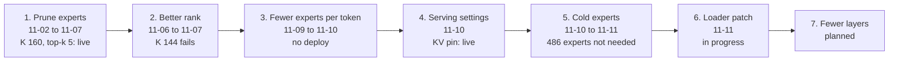

# dsv4-specialize

This repo makes DeepSeek V4 Flash smaller for one workload: a stock-research bot on one NVIDIA DGX Spark. The method
removes the routed experts that the bot's own traffic rarely uses. The pruned model loads 74 GiB in place of 95 GiB,
and the tests found no loss of quality. The bot uses the pruned model since 2026-11-06.

The repo holds the weight tools, the test boots, the run scripts, the plans and the results. It is the record of one
project on one machine. The [timeline](#timeline-of-the-work) shows the seven stages of the work and the files of each
stage. Read [Scope and requirements](#scope-and-requirements) before you try to run it elsewhere.

## Results

The stock model against the pruned model that the bot uses now. [PRUNE.md](PRUNE.md) gives the details.

| Measure | Stock model | Pruned model |
|---|---|---|
| Routed experts per layer (K) | 216 | 160 |
| Experts per token (top-k) | 6 | 5 |
| Loaded weights | 95.39 GiB | 74.09 GiB (−22%) |
| Replay NLL (lower is better; the gate is +3%) | 0.4440 | 0.4524 (+1.89%) |
| Bot decode | 33.64 tok/s | 33.98 tok/s (+1.0%) |
| Code decode | 38.86 tok/s | 42.07 tok/s (+8.3%) |
| LLM judge, 114 pairs against 3 stock runs | — | 44 wins, 19 losses, 51 ties |
| Blind human review, 20 pairs | 6 preferred | 9 preferred (5 ties) |

- The last four rows come from the mask of the same point (K 160, top-k 5). The pruned files matched the mask on the
  replay, and their speed stayed inside the noise ([PRUNE.md](PRUNE.md) §4).
- Read the judge result as "no loss", not as a gain. Against the stock run of the same day, the judge gives 10 wins
  and 9 losses. Most of the wins against the older stock runs come from newer market data.

## How it works

1. **Capture.** A patched server records the experts that the model picks for each token of the bot's own traffic:
   34 calibration segments, 1.75 M tokens ([capture.py](capture.py), [compose-capture.yml](compose-capture.yml),
   [image-patch/](image-patch/)).
2. **Rank.** `capture.py --rank` orders the experts of each layer by their use. The rank of the live model is
   [results/expert_rank_bot.json](results/expert_rank_bot.json).
3. **Mask.** [mask_checkpoint.py](mask_checkpoint.py) builds a copy in which the router never picks a dropped expert
   (see [The mask](#the-mask)). A mask builds in about a minute and does not change the expert weights.
4. **Top-k.** [topk_checkpoint.py](topk_checkpoint.py) lowers the experts per token from 6 to 5. A smaller K alone
   makes the decode slower, because the draft model gets fewer tokens accepted. Top-k 5 gives the speed back.
5. **Prune.** [prune_experts.py](prune_experts.py) removes the dropped experts from the files and gives the kept
   experts new ids. It removed 28,896 tensors (21.27 GiB) and did no new quantization.

Each test point passes four tests in this order: the replay screen, the speed tests, the full runs and the final
review. The [glossary](#glossary) defines each test.

## Timeline of the work

The work ran in seven stages, in this order. Each stage asked one question about the model or the server. The live
model comes from stage 1. The other stages are experiments, and their files stay in the repo as the record.



**Start here.** The live model comes from the three weight tools of stage 1: [mask_checkpoint.py](mask_checkpoint.py),
[topk_checkpoint.py](topk_checkpoint.py) and [prune_experts.py](prune_experts.py). Read them first.

**Shared by all stages:** [run_lib.sh](run_lib.sh) (the safety rules of every run script),
[compose-mask.yml](compose-mask.yml) (the base of every test boot), [speed_result.py](speed_result.py) (the speed
result of a test point) and [overnight_guard.sh](overnight_guard.sh) (it restores the live server at night if the
server is down).

### 1. Prune the routed experts to K 160 (2026-11-02 to 11-07): live

**Question:** can the model lose the experts that the bot rarely uses, fit in about 72 GiB, and keep its quality? A
grid of masks tested K and top-k on the replay screen. The bot's own rank beat the public REAP rank: with REAP, K 192
already fails the NLL gate (+3.31%), but the bot rank costs only +0.29% at K 176. Top-k 4 fails (+6.05%). The pick,
K 160 at top-k 5, passed the final review. The physical prune went live on 2026-11-06, and a draft model built for
the bot rank followed on 2026-11-07.

- Plans: [PLAN_OVERNIGHT_MASK_GRID.md](plans/PLAN_OVERNIGHT_MASK_GRID.md),
  [PLAN_OVERNIGHT_TOPK.md](plans/PLAN_OVERNIGHT_TOPK.md), [PLAN_FINAL_REVIEW.md](plans/PLAN_FINAL_REVIEW.md) and
  [PLAN_PHYSICAL_PRUNE.md](plans/PLAN_PHYSICAL_PRUNE.md). The summary is [PRUNE.md](PRUNE.md) §1–§5.
- Tools: [capture.py](capture.py), [mask_checkpoint.py](mask_checkpoint.py), [topk_checkpoint.py](topk_checkpoint.py),
  [prune_experts.py](prune_experts.py), [prune_run.sh](prune_run.sh) and [check_routed.py](check_routed.py).
- Test boots: [compose-capture.yml](compose-capture.yml), [serve-v1.sh](serve-v1.sh) and
  [compose-mem073.yml](compose-mem073.yml).
- Run scripts: [topk_run.sh](topk_run.sh), [prune_boot.sh](prune_boot.sh), [mem_boot.sh](mem_boot.sh) and
  [draft_test.sh](draft_test.sh).
- Result: [results/expert_rank_bot.json](results/expert_rank_bot.json), the expert rank of the live model.

### 2. Try K 144 with a better rank (2026-11-06 to 11-07): fails

**Question:** can a better rank push the prune to K 144 (about 68 GiB)? The first rank counted how often the router
picked each expert. A patch of the capture also recorded the router weights, so the new ranks could order the experts
by their contribution. K 144 failed the NLL gate with every rank (+3.29% to +3.90%). So K 160 is the floor for this
model without a fine-tune.

- Plan: [PLAN_BETTER_RANK.md](plans/PLAN_BETTER_RANK.md).
- Tools: [rank_data.py](rank_data.py), [rank_report.py](rank_report.py), and the weights patch in
  [image-patch/](image-patch/) (`base_router.py`, `routed_experts_capturer.py` and `capture-weights.diff`).
- Run scripts: [capture_run.sh](capture_run.sh), [rank_masks.sh](rank_masks.sh) and [rank_night.sh](rank_night.sh).

### 3. Use fewer experts per token (2026-11-09 to 11-10): no deploy

**Question:** can each token use fewer than 5 experts, for a faster decode? A router patch dropped expert slots by a
rule, and it could rescale the kept weights (a gain anchor). Every cut below 5 experts failed the NLL gate (+6.4% to
+21.8%), and no point was faster than the live server. The anchored top-5 was a little better on the replay, but the
judge found no gain. So nothing changed on the live server.

- Plan: [PLAN_FEWER_EXPERTS.md](plans/PLAN_FEWER_EXPERTS.md). The summary is [PRUNE.md](PRUNE.md) §6.
- Tools: the router patch in [image-patch/](image-patch/) (`moe_drop.py`, `router-drop.diff` and `build_router.sh`),
  [profile_report.py](profile_report.py) and [fewer_report.py](fewer_report.py).
- Test boot: [compose-drop.yml](compose-drop.yml).
- Run scripts: [fewer_night.sh](fewer_night.sh) and [fewer_stepf.sh](fewer_stepf.sh).

### 4. Tune the serving settings (2026-11-10): the KV pin is live

**Question:** can the server settings give more speed or free memory, with no change to the weights? Of 11 ideas, one
is live: a KV cache pin of 7.25 GiB frees 0.75 GiB. A wider draft model gives +4.2% decode speed for 2.39 GiB, but it
is not deployed. The other ideas fail their gates or cannot run on this stack.

- All files: [serve-tune/](serve-tune/README.md), with its own plan, tools, data and write-up.
- Also: `mask_checkpoint.py --keep-per-layer`, for a different K in each layer.

### 5. Drop the cold experts (2026-11-10 to 11-11): the bot does not need them

**Question:** does the bot need the experts that its traffic rarely uses? The default mask rule keeps 257 "mandatory"
tool experts, and each gets less than 0.1% of the routing weight of its layer. Two replay windows tested masks without
these tool experts, without the coldest ordinary experts, and without both. The cut of both sets, 486 experts, costs
+0.18% NLL against the live set over two replays, under the limit of 0.5%. A prune of these experts would free about
4.29 GiB. But a mask frees no memory, and after the cut each layer keeps a different number of experts.

- Plan: [PLAN_COLD_EXPERTS.md](plans/PLAN_COLD_EXPERTS.md).
- Tools: [cold_sets.py](cold_sets.py) and `mask_checkpoint.py --drop-file`.
- Run script: [cold_replay.sh](cold_replay.sh).

### 6. Prune the cold experts with a loader patch (2026-11-11): done, not deployed

**Question:** can the runtime load a prune with a different number of experts in each layer? The cut of stage 5
keeps 140 to 160 experts per layer, but the runtime accepts one number for all layers. The plan patches the config,
the router, the weight loader and the MoE runtime. The MoE runtime must share one scratch buffer across all expert
counts: one buffer for each count would use more memory than the prune frees. The goal is the prune of the 486 cold
experts at about 69.80 GiB, with the replay result and the speed of the mask. The first step is done:
`prune_experts.py` builds a folder with a different K in each layer. The patch, its tests and the prune of MD are
done too: on the GPU, a layer of the MD prune gives the same output as the same experts of the K 160 prune, bit for
bit, and all expert counts share one scratch buffer. In the test window, the MD prune loaded 69.79 GiB, left
4.18 GiB more memory free, matched the mask on two replays (+0.13%) and kept the bot speed (−1.3%). The code decode
test is 4.9% slower. The deploy review passed on 2026-11-12: the full runs of the MD prune against the live model,
the LLM judge (25 W / 16 L / 35 T, with two controls) and the blind review (9 W / 7 L / 4 T). A deploy is possible;
it waits for your go. The freed memory is for the second model of the router plan.

- Plan: [PLAN_LOADER_PATCH.md](plans/PLAN_LOADER_PATCH.md).
- Tools: [prune_experts.py](prune_experts.py) (§5.1 of the plan), and the patch (§5.2):
  [image-patch/per-layer-experts.diff](image-patch/per-layer-experts.diff),
  [image-patch/build_perlayer.sh](image-patch/build_perlayer.sh) and [compose-perlayer.yml](compose-perlayer.yml).
- Checks: [loader_kernel_check.py](loader_kernel_check.py). Run script: [loader_window.sh](loader_window.sh).
- The deploy review: [PLAN_MD_REVIEW.md](plans/PLAN_MD_REVIEW.md). Run scripts: [review_live.sh](review_live.sh)
  and [review_window.sh](review_window.sh), with the safety net [review_finish.sh](review_finish.sh). Report:
  [review_report.py](review_report.py).
- The deploy: [PLAN_MD_DEPLOY.md](plans/PLAN_MD_DEPLOY.md) (a proposal).

### 7. Remove whole layers (planned)

**Question:** can the model skip whole layers, or one half of a layer? The plan ranks the layers by Block Influence,
measures the best cuts on calibration data, confirms them with the replay gate, and heals each cut with a linear map.
Two whole layers would bring the load from 74.09 GiB to about 71 GiB. The NLL budget is small, so the plan expects
that zero layers is a likely result. Nothing is built yet.

- Plan: [PLAN_FEWER_LAYERS.md](plans/PLAN_FEWER_LAYERS.md).

## Documents

| Document | Read it for |
|---|---|
| [PRUNE.md](PRUNE.md) | The full account: why, the grid of test points, the final review, the physical prune, the open items, and the test of fewer experts per token |
| [plans/README.md](plans/README.md) | The index of the test plans, and how to read their old paths. The scripts cite the plans by section number |
| [serve-tune/README.md](serve-tune/README.md) | The serving settings: 11 ideas for speed and memory, with no change to the weights |
| [RUNBOOK.md](RUNBOOK.md) | The operator steps: the safety rules of the run scripts, the rebuild of the live checkpoint, a mask test by hand and the capture by hand |

## Scope and requirements

The tools and the scripts fit one machine and one bot. They need these parts:

- **Hardware:** one NVIDIA DGX Spark (GB10). The CPU and the GPU share 121 GiB of memory, so only one model fits at
  a time.
- **Server:** the vLLM server of
  [MiaAI-Lab/DeepSeek-v4-Flash-One-DGX-Spark](https://github.com/MiaAI-Lab/DeepSeek-v4-Flash-One-DGX-Spark), in the
  image `ghcr.io/0xsero/deepseek-v4-flash-0731-spark-sparkinfer` (the compose files pin a digest). The scripts expect
  it in `~/Projects/DeepSeek-v4-Flash-One-DGX-Spark`. The live server is a local compose file in that folder,
  `compose-k160t5.yml` (container `deepseek-v4-flash-k160t5-deepseek-v4-flash-1`). The `start.sh` and `stop.sh` of
  that repo control the stock model only.
- **Checkpoint:** the EXL3 checkpoint of DeepSeek V4 Flash in `data/tp1` of that folder, and its DSpark draft. The
  weight tools read this layout only.
- **Python:** Python 3 (tested with 3.13) and numpy run the weight tools and most unit tests. torch and vLLM run only
  inside the server image.
- **The bot repo:** `czhou578/stock-research-agent` is private. It holds the eval harness (`model_eval/`) and the
  recorded bot sessions. Without it, the capture, the replay and the full runs cannot run. It also holds four
  documents that this repo cites by name: `MODEL_PRUNE.md` (what runs now, and how to go back to the stock model),
  `PLAN_MODEL_SPECIALIZE.md` (the method and the harness), `PLAN_E2E_RUNNER.md` (the full runs) and
  `PLAN_MODEL_ROUTER.md` (two models in memory).
- **Paths:** the scripts and the compose files use the paths of the owner's machine.

You can reuse these parts:

- the method and the test results,
- the weight tools, on a DeepSeek V4 Flash EXL3 checkpoint of the same layout, with a rank file from
  `capture.py --rank`,
- the router patch ([image-patch/moe_drop.py](image-patch/moe_drop.py)), as an example of a drop rule in the vLLM
  router.

## Glossary

| Term | Meaning |
|---|---|
| The bot | The stock-research agent that the model serves. It runs on Hermes, calls tools and writes reports |
| Live server | The model server that the bot uses, on port 8888. Test boots use port 8890, so the bot cannot reach a test model |
| Routed expert | One of the 216 feed-forward experts of a MoE layer. The model has 43 layers and picks 6 experts for each token |
| K | The number of routed experts that each layer keeps |
| Top-k | The number of routed experts that each token uses |
| Rank | An order of the experts of each layer by their use. The bot rank comes from the bot's own traffic. REAP is the public rank that comes with the checkpoint (`REAP_K216_PLAN.json`) |
| Mandatory expert | One of the top 32 experts of a layer in either tool category of the REAP rank. `mask_checkpoint.py` keeps it, unless `--drop-file` lists it |
| Mask | A copy of the checkpoint in which the router never picks a dropped expert. All 216 experts still load, so a mask tests the quality, not the memory |
| Prune | A copy that holds only the kept experts. It frees the memory |
| Replay screen | The first quality test: 60 recorded bot turns. It reads the NLL of the recorded output, the decisions and the tool names |
| NLL | The negative log-likelihood of the recorded output, summed over the replay. Lower is better. The NLL gate allows at most +3% against the stock model |
| Speed tests | The bot decode test replays recorded bot requests. The code decode test runs the benchmark script of the server repo. A change counts only above the noise floor |
| Full runs | The bot runs held-out prompts end to end on the test model, and gates check the results |
| Final review | An LLM judge and a blind human review compare the replies of the full runs with the replies of the stock model |
| DSpark | The draft model of the speculative decoding, cut from the model's own multi-token-prediction layer. It proposes 5 tokens, and the target model checks them in one pass |
| Acceptance | The mean number of draft tokens that pass the check in one step |
| EXL3 | The quantization format of the checkpoint |
| Model Runner V1, V2 | Two engine modes of vLLM. The live server uses V2. Only V1 accepts the flag that returns the routed experts, so the capture uses V1 |
| Test window | A time in which a run script stops the live server, runs test boots and restores the live server |

## Files

The tables below sort the files by type. The [timeline](#timeline-of-the-work) sorts them by stage.

Run the Python files with the stock-research venv: `~/.hermes/stock-research/.venv/bin/python`.

`PLAN_MODEL_SPECIALIZE.md`, `PLAN_MODEL_ROUTER.md` and `PLAN_E2E_RUNNER.md` are in the private bot repo (see
[Scope and requirements](#scope-and-requirements)). The other plans are in [plans/](plans/README.md).

**Weight tools.** Each tool writes a new folder and never changes its source.

| File | Use |
|---|---|
| [mask_checkpoint.py](mask_checkpoint.py) | Builds `tp1-mask-k{K}/`: K of 216 experts per layer stay (`PLAN_MODEL_SPECIALIZE.md` §5.3). With `--rank <rank file>`, the bot rank decides the dropped experts (§6.5); the folder is then `tp1-botmask-k{K}/`. With `--keep-per-layer FILE` (a JSON list from `serve-tune/alloc_k.py`), each layer keeps its own K; `--out` is then needed. With `--drop-file FILE` (from `cold_sets.py`), it drops exactly the listed ids, a mandatory expert too |
| [cold_sets.py](cold_sets.py) | The drop files of `plans/PLAN_COLD_EXPERTS.md` §4: R0 (the live set as a mask), M1 (cold tool experts), D1 (cold ordinary experts) and MD (both). `--report R0.jsonl POINT.jsonl` compares a replay with R0 (§5.2) |
| [topk_checkpoint.py](topk_checkpoint.py) | Builds a top-k copy of a tp1 folder (§8): `--source tp1-botmask-k160 --top-k 5 --out tp1-botmask5-k160`. `--check` runs the self-check only |
| [prune_experts.py](prune_experts.py) | Builds a physically pruned copy of a mask folder (`PLAN_PHYSICAL_PRUNE.md` §3): the dropped experts leave the files, and the kept experts get the new ids 0 … K−1. A mask with a different K in each layer gives a folder for the loader patch (`plans/PLAN_LOADER_PATCH.md` §4.1). `--check` runs the self-check only |
| [prune_run.sh](prune_run.sh) | Runs `prune_experts.py` in a root container from the server image, because the 43 expert files of `data/tp1` are `root:600`. The main server stays up |
| [check_routed.py](check_routed.py) | The `PLAN_MODEL_SPECIALIZE.md` §5.2 check: no dropped expert in the routing of a test boot |
| [speed_result.py](speed_result.py) | The §4.4 speed result of one test point, from the files in `results/` |
| [fewer_report.py](fewer_report.py) | The replay table of the points of `plans/PLAN_FEWER_EXPERTS.md` §7 against the baseline, and the decision for Phase D (`--decide`) |

**Rank tools.** They need the bot repo's eval worktree, `~/Projects/stock-research-model-eval`: `capture.py` and
`rank_data.py` import its `model_eval/replay.py`, and the rank data is its `model_eval/data/rank/` (out of git). They
moved here from the bot repo's `model_eval/` on 2026-11-08.

| File | Use |
|---|---|
| [capture.py](capture.py) | The client of the capture boot (`PLAN_MODEL_SPECIALIZE.md` §6.2, `plans/PLAN_BETTER_RANK.md` §4): per segment, the counts of the routed experts and, with `--sums`, the router weights. `--rank` writes `expert_rank_<order>.json` |
| [rank_data.py](rank_data.py) | Merges the exports into `model_eval/data/rank/sessions.jsonl` and keeps the held-out sessions out (`plans/PLAN_BETTER_RANK.md` §3) |
| [profile_report.py](profile_report.py) | The routing profile of a capture with `ROUTING_PROFILE=1` (`plans/PLAN_FEWER_EXPERTS.md` §5): the share of the 5th and 6th experts per layer and skill, the experts per token and the window union of each drop rule, and the threshold for point C5 |
| [rank_report.py](rank_report.py) | Compares the rank files in `results/`: the routing share that each K step removes, and the overlaps (`plans/PLAN_BETTER_RANK.md` §5) |

**Test boots.** Each compose file serves on port 8890, so the bot (port 8888) cannot reach a test model.

| File | Use |
|---|---|
| [compose-mask.yml](compose-mask.yml) | Boots `tp1-${MASK_NAME}-k${MASK_K}`. `DRAFT_DIR` mounts another DSpark draft; `MASK_EXTRA_ARGS` adds vLLM flags |
| [compose-mem073.yml](compose-mem073.yml) | Override for `compose-mask.yml`: `GPU_MEMORY_UTILIZATION` 0.73 and 128k context (`PLAN_MODEL_ROUTER.md` §3) |
| [compose-drop.yml](compose-drop.yml) | Override for `compose-mask.yml`: the router patch with its rule (`MOE_DROP`, `MOE_NORM`, `MOE_LAYERS`) and an 8 GiB KV cache (`plans/PLAN_FEWER_EXPERTS.md` §6) |
| [compose-perlayer.yml](compose-perlayer.yml) | Override for `compose-mask.yml`: the loader patch, so a folder with a different expert count in each layer loads (`plans/PLAN_LOADER_PATCH.md` §4). A uniform folder loads as in the stock image. Build the two files first with `image-patch/build_perlayer.sh` |
| [compose-capture.yml](compose-capture.yml) | The expert capture: the stock model with Model Runner V1, no DSpark, `--enable-return-routed-experts` and the weights patch. `ROUTING_PROFILE=1` adds the routing profile; `CAPTURE_UTIL` and `CAPTURE_EXTRA_ARGS` change the boot check and add vLLM flags |
| [serve-v1.sh](serve-v1.sh) | Runs the server's serve script with Model Runner V1 (for `compose-capture.yml` only) |
| [image-patch/](image-patch/) | The weights patch (`PLAN_BETTER_RANK.md` §4.1): the patched `base_router.py` and `routed_experts_capturer.py`, and `capture-weights.diff`, the change against the image. `patch -R -p1` with the diff gives back the original files. The router patch (`PLAN_FEWER_EXPERTS.md` §6): `moe_drop.py` (the drop rule and the gain anchor) and `router-drop.diff`; `build_router.sh` applies the diff to the image's router file (not in git). The loader patch (`plans/PLAN_LOADER_PATCH.md` §4): `per-layer-experts.diff` changes the image's `exl3.py` and DeepSeek V4 `model.py`; `build_perlayer.sh` applies it and writes `image-patch/perlayer/` (not in git) |

**Run scripts.** Each script stops the live server, runs its test boots and restores the live server. Read the
safety rules in [RUNBOOK.md](RUNBOOK.md) before you start one.

| File | Use |
|---|---|
| [run_lib.sh](run_lib.sh) | The shared functions and safety rules of the scripts below. A script sets `LOG`, `RESTORE_TAG` and, if it needs them, `TEST_COMPOSE`, `TEST_PROJECT` and `MASK`, then sources this file |
| [topk_run.sh](topk_run.sh) | The top-k test night (`PLAN_OVERNIGHT_TOPK.md` §5 and §6) |
| [prune_boot.sh](prune_boot.sh) | The test boot of the pruned folder: replay, speed tests (`PLAN_PHYSICAL_PRUNE.md` §6) |
| [mem_boot.sh](mem_boot.sh) | The memory test boot at 0.73 and 128k: boot lines, free memory at idle and under load (`PLAN_MODEL_ROUTER.md` §3) |
| [draft_test.sh](draft_test.sh) | The pruned model with another DSpark draft (`DRAFT_DIR`): the two decode tests (`PLAN_PHYSICAL_PRUNE.md` §7) |
| [capture_run.sh](capture_run.sh) | The capture boot (`PLAN_BETTER_RANK.md` §4): a smoke test of the sums file, the capture of `model_eval/data/rank`, the rank files |
| [rank_masks.sh](rank_masks.sh) | Builds the mask folders of `PLAN_BETTER_RANK.md` §6 from the stock model (`RANK_NEW` picks the rank file). No downtime |
| [rank_night.sh](rank_night.sh) | Masks on the replay screen (`PLAN_BETTER_RANK.md` §6). `POINTS` lists them as `NAME:K`; the default is the three masks of §6.1 |
| [fewer_night.sh](fewer_night.sh) | The test night of `plans/PLAN_FEWER_EXPERTS.md`: the routing profile (Phase A), then the replay points C1–C5 and C0 on `tp1-botmask-k160` with `compose-drop.yml` (Phase C), then 5 bot decode runs on the chosen point and 5 on the live server (Phase D). `BOOT_MIN_GIB` makes each boot wait for that much available memory |
| [fewer_stepf.sh](fewer_stepf.sh) | Step F of `plans/PLAN_FEWER_EXPERTS.md` §9 on one point (`POINT`, `MOE_DROP`, `MOE_NORM`; `MASK_NAME=prune5` boots the live folder): optional replay (`REPLAY=1`) and speed tests (`SPEED=1`, gate `SPEED_MIN`), the 19 held-out prompts end to end, the restore, the checks, the judge and the blind page |
| [cold_replay.sh](cold_replay.sh) | The replay window of `plans/PLAN_COLD_EXPERTS.md` §7: the masks R0, M1, D1 and MD (`cold_sets.py`), each with the smoke requests, the replay and the comparisons against R0 and the baseline. It stops after R0 if R0 does not match the earlier K 160 mask. The test boots pin the KV at 7.25 GiB |
| [loader_window.sh](loader_window.sh) | The test window of `plans/PLAN_LOADER_PATCH.md` §6: the patched image (`compose-perlayer.yml`) on the K 160 prune (P0: smoke, speed, prefill probe) and on the MD prune (P1: also two replays). After the restore it logs the gates of §6.1: the loaded GiB, the free memory, the speed of P1 against P0, and the mean NLL of P1 against the MD mask |
| [review_live.sh](review_live.sh) | The base runs of `plans/PLAN_MD_REVIEW.md` §4: the 19 held-out prompts end to end on the live server (no downtime), once for each label of `LABELS`, then the checks |
| [review_window.sh](review_window.sh) | The test window of `plans/PLAN_MD_REVIEW.md` §5 and §6: after the base runs, the MD prune on the patched image (smoke, then the 19 held-out prompts for each label of `LABELS`), the restore, the checks against the live runs, the blind page, the judge with its controls, and the report (`review_report.py`) |
| [review_finish.sh](review_finish.sh) | The safety net of `plans/PLAN_MD_REVIEW.md` §6.1: after `review_window.sh` ends, for any reason, and the live server is healthy, it does each step again that is not complete: the checks, the blind page, the judge calls (3 attempts each) and the report |
| [overnight_guard.sh](overnight_guard.sh) | At 04:15 and 04:35, restores the live server (`MAIN_COMPOSE`, default `compose-k160t5.yml`) if port 8888 is down. `DRY_RUN=1` logs the actions only |

**Not in git.** The test checkpoints (`tp1-*`), the kernel cache copy (`cache/`), the capture output
(`capture-out/`), the wide drafts (`dspark-draft-*/`), the result files (`results/`, except
`results/expert_rank_bot.json`), the logs (`logs/`) and `history/hermes-e2e/`: the step scripts of the full runs and
their logs, moved from `~/.hermes-e2e/` on 2026-11-08. The step scripts keep their old paths, so they do not run as
they are.

## Tests

Run the unit tests from the repo root:

```bash
python -m unittest
```

- `test_mask_checkpoint.py`, `test_topk_checkpoint.py` and `test_prune_experts.py` run each weight tool on a small
  synthetic checkpoint. They need only numpy.
- `test_check_routed.py` uses synthetic routing data, `test_profile_report.py` uses synthetic profile rows, and
  `test_cold_sets.py` uses a synthetic plan and rank.
- `test_capture.py` and `test_rank.py` use a fake server and synthetic sums. They import `capture.py`, so they need
  the eval worktree of the bot repo.
- `test_serve_tune.py` runs the tests of [serve-tune/](serve-tune/README.md). unittest cannot import a folder name
  with a hyphen, so this file adds the folder to the path.
- `test_moe_drop.py` (the router patch and the profile hook) needs torch and vLLM. `./test_moe_drop.sh` runs it in
  the server image.
- `test_loader_patch.py` (the loader patch, `plans/PLAN_LOADER_PATCH.md` §5.2) also needs vLLM. Build
  `image-patch/perlayer/` first with `image-patch/build_perlayer.sh`, then `./test_loader_patch.sh` runs it in the
  server image.
- `test_review_report.py` tests the rules of `review_report.py` (the sign-test line, the controls, the weak
  prompts, the skills and the run times) on synthetic rows.
- `./loader_kernel_check.sh` runs the GPU check of §5.3 (`loader_kernel_check.py`): the real experts of one layer of
  the K 160 prune and of the MD prune, through the patched loader. It uses about 3 GiB of GPU memory beside the live
  server, so run it only when the bot is idle.

## Run the scripts

CAUTION: Each run script stops the bot's model server. Read the safety rules in [RUNBOOK.md](RUNBOOK.md) before you
start a script.

[RUNBOOK.md](RUNBOOK.md) holds the operator steps:

- The safety rules of the run scripts, and how to start a script with its deadlines.
- The rebuild of the live checkpoint.
- One mask test by hand.
- The expert capture by hand.

## The mask

- Layers 3–42: `gate.bias = -1e4` for each dropped expert. The router never chooses it. The kept experts keep their
  choice and their weights.
- Layers 0–2 (hash routing): each `tid2eid` entry of a dropped expert moves to the kept expert with the most similar
  router row. That expert must not be in the token's row yet, and its load must be below twice the mean.
- `MASK.json` in each folder records the dropped experts (current and original ids) and the rule.

## License

MIT. See [LICENSE](LICENSE).
